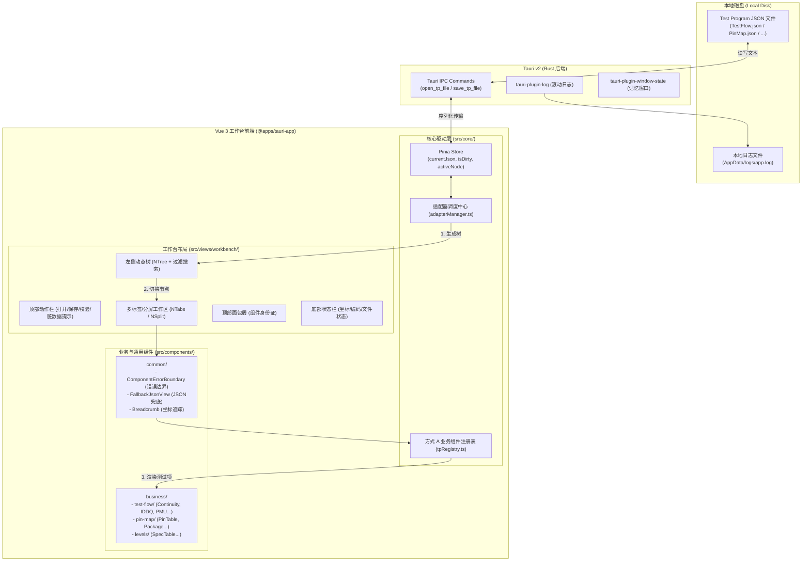
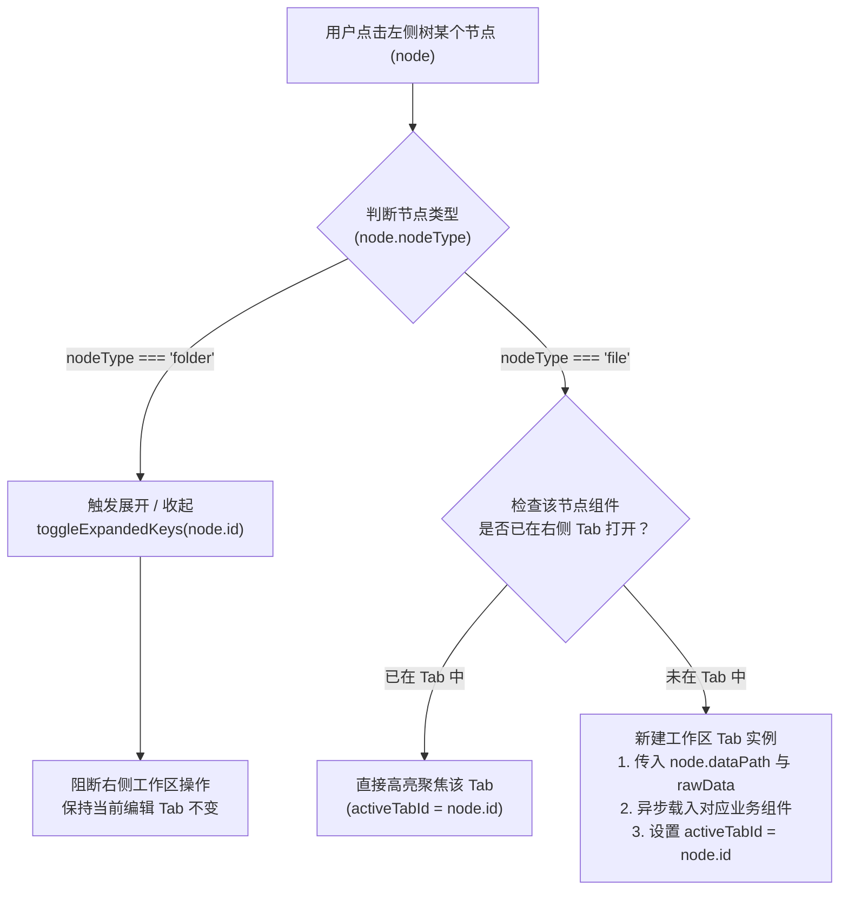
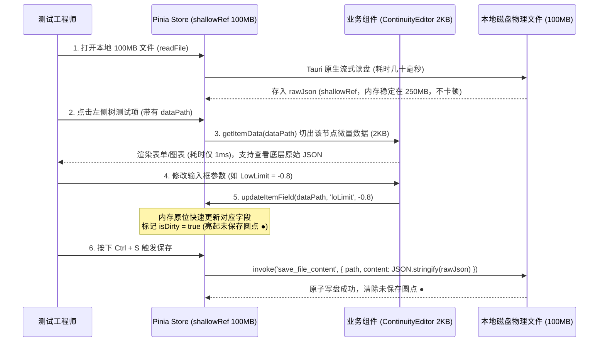
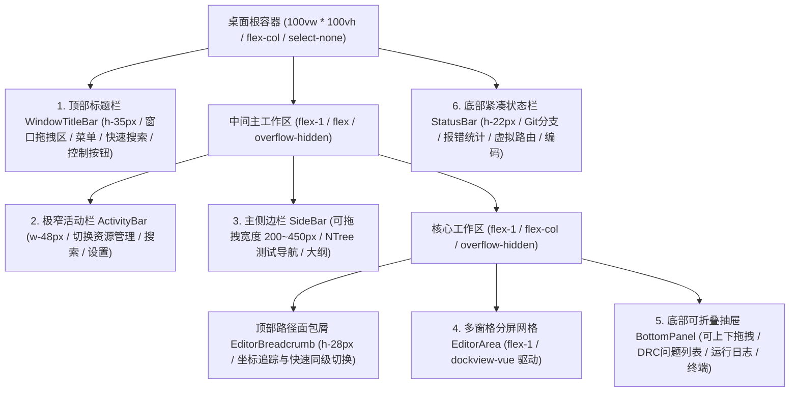
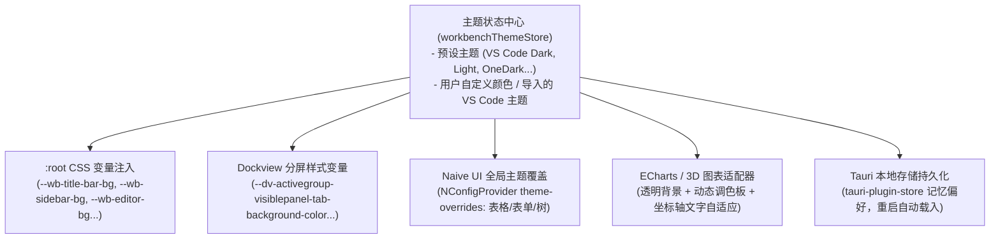
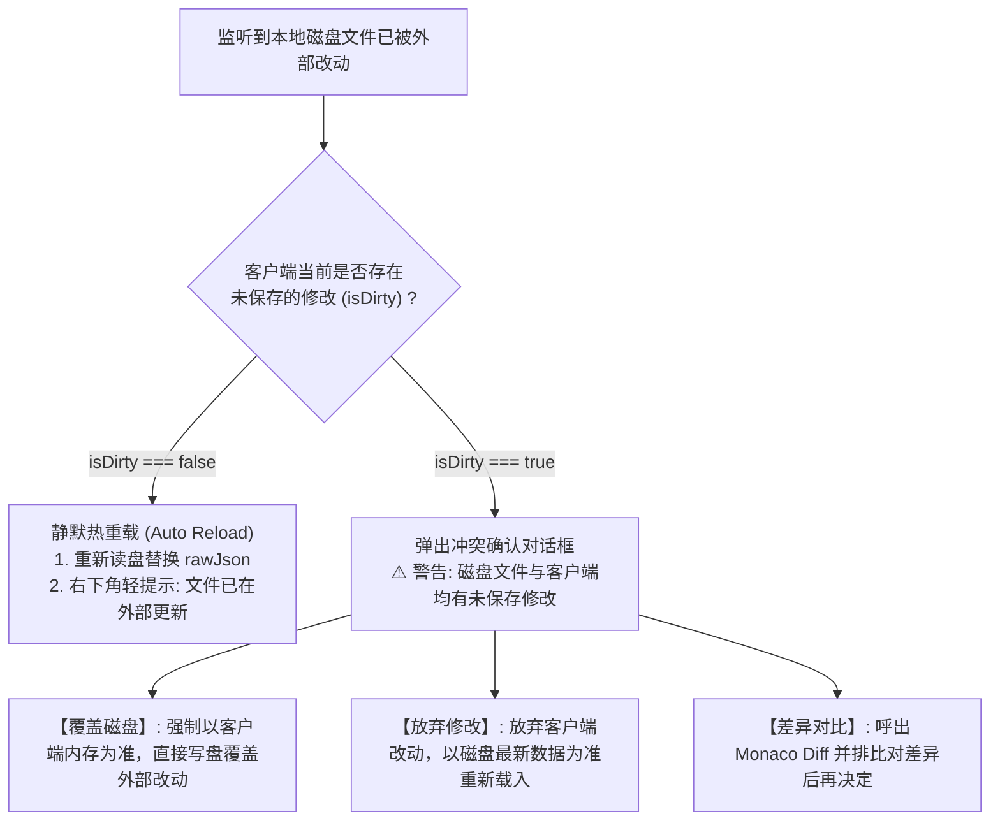

# ATE 芯片测试程序 (Test Program) 可视化工作台设计规范

## 1. 项目背景与业务定位

### 1.1 业务背景
在半导体 ATE（Automated Test Equipment，自动测试设备）芯片测试领域，测试程序（Test Program，简称 TP）通常由包含芯片测试配置的大量 JSON（或基于 JSON 格式的元数据）文件组成，例如：
* `TestFlow.json` / `*_tp.json`：测试流、测试套件（TestSuite）及具体测试项（Continuity, IDDQ, DC, AC, Function, Shmoo 等）；
* `PinMap.json`：芯片管脚定义、通道映射（Channel Mapping）与电源管脚分组；
* `Levels.json` / `Specs.json`：直流参数与电平规范（VCC, VOH/VOL, VIH/VIL, Clamp 等）；
* `Timing.json`：时钟域、时序波形与周期配置；
* `BinTable.json`：硬分档（Hard Bin）与软分档（Soft Bin）策略。

以往测试工程师修改参数需要直接编辑复杂的文本/代码文件，容易出现漏配、上下限写反、参数越界等人为事故。

### 1.2 目标定位
基于仓库现有 **Tauri v2 + Vue 3.5 + Naive UI + UnoCSS** 架构，在 `@apps/tauri-app` 中构建一个类似 **VS Code 布局的 ATE 可视化桌面客户端**：
1. **数据驱动与目录/文件分层语义**：用户导入/打开本地 JSON 文件，系统自动匹配并提取专属的树形测试导航。左侧树严格区分 **“文件夹（Folder）”** 与 **“文件（File）”** 两种节点：
   * **文件夹节点（如测试套件 TestSuite、参数组 Category）**：点击行或展开箭头**仅触发目录展开与收起（Expand / Collapse）**，不会在右侧打开标签页或切换视图；
   * **文件节点（如具体的某个测试项 Continuity_1、IDDQ_2、PinMap 等叶子节点）**：点击**触发在右侧多标签区打开/聚焦自定义业务组件**，进行可视化渲染与编辑。
2. **方式 A 显式组件映射**：所有业务组件收敛在 `src/components/business/`，通过强类型注册表显式按需引入；
3. **双向响应式与闭环保存**：界面修改参数实时同步到内存响应式模型，`Ctrl + S` 进行 DRC 规则校验并安全写回本地磁盘；
4. **工业级排障定位**：在无浏览器地址栏的环境下，具备面包屑坐标显示、组件级错误边界诊断卡（防白屏）及本地黑匣子日志追踪能力。

---

## 2. 总体架构设计

### 2.1 核心分层架构图



---

## 3. 目录组织规范（采用方式 A）

所有新增业务与排障组件均遵循项目现有架构规范，统一收敛在 `src/components/` 下，不再新建顶级目录：

```
apps/tauri-app/src/
├── components/
│   ├── common/                               # 通用底座与排障诊断组件
│   │   ├── ComponentErrorBoundary.vue        # 组件级防白屏错误捕获边界
│   │   ├── FallbackJsonView.vue              # 缺少对应组件时的原始 JSON 兜底预览
│   │   ├── TpBreadcrumb.vue                  # 顶部面包屑坐标栏
│   │   └── TpStatusBar.vue                   # 底部状态栏定位信息
│   │
│   └── business/                             # 【核心】所有内置 ATE 业务组件
│       ├── test-flow/                        # 测试流与具体测试项配置
│       │   ├── ContinuityEditor.vue          # 开短路 (Continuity / Contact) 测试
│       │   ├── IddqEditor.vue                # 静态功耗电流 (IDDQ) 测试
│       │   ├── PmuForceEditor.vue            # PMU 加压测流参数配置
│       │   ├── SuiteSummary.vue              # 测试套件总览配置
│       │   └── ShmooScanEditor.vue           # Shmoo 扫描范围与步长配置
│       ├── pin-map/                          # 管脚配置
│       │   ├── PinTableEditor.vue            # 管脚分配表格
│       │   └── PackageDiagram.vue            # 芯片封装/引脚分布可视化
│       └── levels/                           # 直流电平参数
│           └── SpecTableEditor.vue           # 规格参数表 (VCC, VIL, VIH, VOL, VOH)
│
├── core/                                     # ATE 核心契约与驱动引擎
│   ├── tpModule.ts                           # 适配器接口与树节点类型定义
│   └── adapterManager.ts                     # 模块适配器加载与文件匹配管理器
│
├── constants/
│   └── tpRegistry.ts                         # 【方式 A】强类型组件注册表
│
├── layouts/
│   ├── base-layout/                          # 【保留原样】原有管理后台布局（零改动）
│   ├── blank-layout/                         # 【保留原样】空白全屏布局
│   └── workbench-layout/                     # 【新增】专属 ATE VS Code 工业级 IDE 布局
│       ├── index.vue                         # 顶层布局外壳 (100vh 满屏网格装配)
│       ├── modules/
│       │   ├── WindowTitleBar.vue            # 1. 顶部标题栏 (菜单/全局搜索/窗口控制)
│       │   ├── ActivityBar.vue               # 2. 极窄 48px 图标导航栏 (切换测试树/设置)
│       │   ├── SideBar/                      # 3. 可伸缩主侧边栏 (挂载 NTree 测试项树)
│       │   │   ├── index.vue                 # 侧栏容器 (支持拖拽调节宽度与折叠)
│       │   │   └── ExplorerTree.vue          # 测试项树 (区分 folder/file 交互)
│       │   ├── EditorArea/                   # 4. 【核心编辑区 - dockview-vue 驱动】
│       │   │   ├── index.vue                 # DockviewVue 分屏网格宿主
│       │   │   ├── EditorBreadcrumb.vue      # 顶部路径面包屑
│       │   │   ├── EditorWatermark.vue       # 无 Tab 时的快捷键与引导水印
│       │   │   └── theme.css                 # VS Code 官方深色主题样式注入
│       │   ├── BottomPanel.vue               # 5. 底部可折叠面板 (DRC问题/日志/输出)
│       │   └── StatusBar.vue                 # 6. 底部 22px 紧凑状态栏 (状态与编码)
│
├── store/modules/
│   ├── tpStore.ts                            # ATE 测试数据源与业务状态中心
│   ├── workbenchLayoutStore.ts               # 工作台布局折叠状态与 Dockview API 实例
│   └── workbenchThemeStore.ts                # 【新增】工作台主题切换与自定义颜色状态
│
├── theme/
│   ├── settings.ts                           # 现有全局主题配置 (默认深色 #007acc)
│   ├── workbenchTheme.ts                     # 【新增】工作台预设主题与 VS Code 色值映射
│   └── naiveTheme.ts                         # 【新增】Naive UI 业务组件全局深色覆盖配置
│
└── views/
    └── workbench/                            # 业务视图入口
        └── index.vue                         # 承载工作台业务逻辑 (注入模块适配器)
```

---

## 4. 方式 A：强类型业务组件注册表设计

采用**显式引用 + `defineAsyncComponent` 异步分包**方式，具有以下绝对优势：
* **强类型提示与编译安全**：杜绝拼写错误，若组件重命名或删除，TypeScript 编译期立即报错拦截；
* **按需打包加载**：各测试项代码独立分包，即使有上百个业务组件，也不会导致启动包体积膨胀；
* **符合团队维护习惯**：每个组件来源一目了然，方便代码审查（Code Review）与依赖追溯。

### 4.1 注册表实现 (`src/constants/tpRegistry.ts`)

```ts
import { defineAsyncComponent, type Component } from 'vue'

/**
 * 方式 A：显式业务组件字典
 * 键名为 JSON 节点声明的 componentKey 或 testType
 */
export const TP_COMPONENTS = {
  // ─── 测试流 (TestFlow) ──────────────────────────
  SuiteSummary: defineAsyncComponent(() => import('@/components/business/test-flow/SuiteSummary.vue')),
  Continuity: defineAsyncComponent(() => import('@/components/business/test-flow/ContinuityEditor.vue')),
  IDDQ: defineAsyncComponent(() => import('@/components/business/test-flow/IddqEditor.vue')),
  PMU_Force: defineAsyncComponent(() => import('@/components/business/test-flow/PmuForceEditor.vue')),
  ShmooScan: defineAsyncComponent(() => import('@/components/business/test-flow/ShmooScanEditor.vue')),

  // ─── 管脚定义 (PinMap) ───────────────────────────
  PinTable: defineAsyncComponent(() => import('@/components/business/pin-map/PinTableEditor.vue')),
  PackageDiagram: defineAsyncComponent(() => import('@/components/business/pin-map/PackageDiagram.vue')),

  // ─── 电平参数 (Levels) ───────────────────────────
  SpecTable: defineAsyncComponent(() => import('@/components/business/levels/SpecTableEditor.vue')),
} as const

/** 业务组件键名联合类型，用于全流程类型守卫 */
export type TPComponentKey = keyof typeof TP_COMPONENTS

/** 安全获取已注册组件，未命中返回 undefined */
export function getBusinessComponent(key: string): Component | undefined {
  if (key in TP_COMPONENTS) {
    return TP_COMPONENTS[key as TPComponentKey]
  }
  return undefined
}
```

---

## 5. 核心接口契约与数据模型

### 5.1 统一接口规范 (`src/core/tpModule.ts`)

```ts
/** 树节点类型：folder(纯分类/套件文件夹) | file(具体测试项业务文件) */
export type TPTreeNodeType = 'folder' | 'file'

/** 树节点抽象模型 */
export interface TPTreeNode {
  /** 节点唯一主键 (如 'suite-0-item-3') */
  id: string
  /** 节点显示名称 (如 'Continuity_Test' 或 'DC_TestSuite') */
  label: string
  /** 节点类型：folder 仅支持展开/收起；file 点击触发打开对应业务组件 */
  nodeType: TPTreeNodeType
  /** 图标标识符 (可按测试类型动态指定) */
  icon?: string
  /** 映射渲染的业务组件键名 (nodeType === 'file' 时必填，必须受控于 TPComponentKey) */
  componentKey?: string
  /** 当前节点数据在原始主 JSON 中的寻址路径，支持深层嵌套 (例如: ['testSuites', 0, 'items', 3]) */
  dataPath?: (string | number)[]
  /** 传入业务组件的原始节点数据快照/引用 (nodeType === 'file' 时有效) */
  rawData?: Record<string, any>
  /** 子节点列表 (nodeType === 'folder' 时存在) */
  children?: TPTreeNode[]
}

/** 模块适配器规范 (用于不同 JSON 文件的特征路由与树提取) */
export interface TPModuleAdapter {
  id: string
  name: string
  /** 1. 匹配规则：根据文件名或 JSON 内容判断是否归属该模块 */
  match: (fileName: string, jsonContent: any) => boolean
  /** 2. 树生成器：从该模块特定的 JSON 结构提取标准树结构 (标注清楚 folder 与 file) */
  buildTree: (jsonContent: any) => TPTreeNode[]
  /** 3. 校验器：保存前的硬件/DRC 规则检查 (可选) */
  validate?: (jsonContent: any) => { valid: boolean; errors: string[] }
}
```

### 5.2 树形节点交互协议与分流设计 (Folder VS File 模式)

在左侧测试导航树中，必须严格隔离 **“文件夹（分组）”** 与 **“文件（测试项）”** 的交互行为，防止点击文件夹意外打乱右侧已打开的编辑区：

#### 5.2.1 节点行为对照矩阵

| 交互行为 | 文件夹节点 (`nodeType: 'folder'`) | 文件节点 (`nodeType: 'file'`) |
| :--- | :--- | :--- |
| **典型代表** | `TestSuite_Basic`、`PinGroups`、`Category` | `Continuity_Item`、`IDDQ_Test`、`SpecTable` |
| **点击整行 / 箭头** | **仅切换展开/收起状态** (`toggleExpand`) | **打开/聚焦右侧工作区标签页** (`openTab`) |
| **右侧工作区联动** | **无任何影响**，不打开新 Tab，不切换当前 Tab | 打开对应业务组件 Tab（若已打开则直接高亮聚焦） |
| **高亮选中态 (Selected)** | **不选中**（避免视觉误导为当前正在编辑该目录） | **高亮选中**，并与右侧激活的 Tab 实时保持双向同步 |
| **图标表现 (Icon)** | 折叠状态显示 `FolderOutlined`，展开显示 `FolderOpenOutlined` | 显示测试项专属图标（如 ⚡, 📐, 📊 等） |

#### 5.2.2 树节点点击事件流图



#### 5.2.3 Naive UI (`NTree`) 核心实现方案

在 `src/views/workbench/modules/WorkbenchSidebar.vue` 中，利用 `NTree` 的 `node-props` 配合受控状态实现精准分流：

```vue
<script setup lang="ts">
import { ref } from 'vue'
import { useTpStore } from '@/store/modules/tpStore'
import type { TPTreeNode } from '@/core/tpModule'

const tpStore = useTpStore()

// 记录所有当前展开的文件夹 ID 集合
const expandedKeys = ref<string[]>([])

// 节点属性与事件拦截
function nodeProps({ option }: { option: TPTreeNode }) {
  return {
    onClick: () => {
      if (option.nodeType === 'folder') {
        // 【文件夹节点】：点击整行直接展开或收起，不切换右侧视图
        const index = expandedKeys.value.indexOf(option.id)
        if (index > -1) {
          expandedKeys.value.splice(index, 1)
        } else {
          expandedKeys.value.push(option.id)
        }
      } else {
        // 【文件节点】：触发工作区打开对应自定义业务组件
        tpStore.openTab(option)
      }
    }
  }
}
</script>

<template>
  <NTree
    block-line
    expand-on-click
    :data="tpStore.treeData"
    :expanded-keys="expandedKeys"
    :selected-keys="[tpStore.activeNodeId]"
    :node-props="nodeProps"
    key-field="id"
    label-field="label"
    children-field="children"
  />
</template>
```

---

### 5.3 大体积 (100MB 级别) JSON 数据治理与“浅响应切片”读写架构

针对 ATE 芯片测试程序文件大（可达 20MB ~ 100MB）、包含数万个引脚与测试项的极端工况，本系统确立 **“彻底弃用 IndexedDB，采用内存 shallowRef 浅响应 + dataPath 局部按需切片 + 本地物理文件直接原子落盘”** 的核心原则。

#### 5.3.1 为什么坚决不使用 IndexedDB？
1. **序列化假死**：IndexedDB 依赖结构化克隆（Structured Clone），每次读写 50~100MB 数据会导致浏览器主线程卡死 500ms ~ 2 秒；
2. **静默丢数据风险**：工控机磁盘空间不足（剩余空间 < 10%）时，Chromium / WebKit 内核会触发自动驱逐（Eviction）机制，静默清空 IndexedDB；
3. **避免数据双重冗余**：测试机台最终运行的是磁盘上的物理 `.json` 文件，直接面向本地文件操作，不引入中间数据库造成数据不同步。

#### 5.3.2 性能保障核心原理：“大树只读，小枝响应”
* 100MB JSON 读入内存解析为原生 JS 对象后，仅占用约 **250MB ~ 300MB** 内存（在 16G 电脑中占比不到 2%）；
* 使用 **`shallowRef`** 存储主对象，严禁 Vue 递归创建 Proxy 依赖，内存维持在 250MB，CPU 占用率 0%；
* 仅当用户在左侧树点开某个具体测试项时，利用 `dataPath` 顺藤摸瓜将该节点所属的 **几 KB 小微数据切片** 提取出来传给业务组件进行响应式编辑；
* 业务组件修改参数时，顺着路径原位更新 `shallowRef` 内的对应字段，耗时仅 0.0001 毫秒，触发未保存标记 `●`；
* 用户按 `Ctrl + S`，Tauri 将内存中的完整对象原子覆盖写回本地磁盘。



---

#### 5.3.3 落地代码实战闭环

##### 1. Pinia 数据驱动中心 (`src/store/modules/tpStore.ts`)
```ts
import { defineStore } from 'pinia'
import { shallowRef, ref } from 'vue'
import { invoke } from '@tauri-apps/api/core'

/** 极速路径寻址：根据数组路径直接在 100MB 大对象中取值 (耗时 0.0001ms) */
function getByPath(obj: any, path: (string | number)[]) {
  return path.reduce((acc, key) => (acc ? acc[key] : undefined), obj)
}

export const useTpStore = defineStore('tpStore', () => {
  // 【100MB 大底座】：用 shallowRef 存！Vue 绝不递归创建 Proxy，内存仅 ~250MB，零卡顿
  const rawJson = shallowRef<any>(null)
  const filePath = ref('')
  const isDirty = ref(false)

  /** 打开本地文件 */
  async function loadFile(selectedPath: string) {
    filePath.value = selectedPath
    const fileContent: string = await invoke('read_file_content', { path: selectedPath })
    rawJson.value = JSON.parse(fileContent)
    isDirty.value = false
  }

  /** 【取数据】：按路径仅抠出当前测试项的微量数据 (仅 2KB) */
  function getItemData(dataPath: (string | number)[]) {
    if (!rawJson.value) return null
    return getByPath(rawJson.value, dataPath)
  }

  /** 【改数据】：精准修改内存大对象中的对应字段 */
  function updateItemField(dataPath: (string | number)[], field: string, newValue: any) {
    const item = getItemData(dataPath)
    if (item) {
      item[field] = newValue
      isDirty.value = true // 亮起未保存圆点 ●
    }
  }

  /** 【存数据】：Ctrl+S 直接将完整 rawJson 原子写回本地文件 */
  async function saveFile() {
    if (!filePath.value || !rawJson.value) return
    const content = JSON.stringify(rawJson.value, null, 2)
    await invoke('save_file_content', { path: filePath.value, content })
    isDirty.value = false // 消除未保存圆点
  }

  return { rawJson, filePath, isDirty, loadFile, getItemData, updateItemField, saveFile }
})
```

##### 2. 容器分发调度层 (`src/views/workbench/modules/WorkbenchWorkspace.vue`)
```vue
<script setup lang="ts">
import { computed } from 'vue'
import { useTpStore } from '@/store/modules/tpStore'
import { TP_COMPONENTS } from '@/constants/tpRegistry'

const props = defineProps<{
  activeNode: {
    label: string
    componentKey: string
    dataPath: (string | number)[]
  }
}>()

const tpStore = useTpStore()

// 顺着 dataPath 仅切出当前测试项所需的微量数据 (几 KB)
const currentItemData = computed(() => tpStore.getItemData(props.activeNode.dataPath))

// 匹配对应的业务组件
const CurrentComponent = computed(() => TP_COMPONENTS[props.activeNode.componentKey])
</script>

<template>
  <div class="h-full w-full overflow-hidden">
    <!-- 把微量切片数据与路径注入给具体业务组件 -->
    <component
      :is="CurrentComponent"
      v-if="currentItemData"
      :data="currentItemData"
      :data-path="activeNode.dataPath"
    />
  </div>
</template>
```

##### 3. 业务组件实战：看数据、改数据与查看原始 JSON (`src/components/business/test-flow/ContinuityEditor.vue`)
```vue
<script setup lang="ts">
import { ref } from 'vue'
import { useTpStore } from '@/store/modules/tpStore'

const props = defineProps<{
  data: {
    testName: string
    loLimit: number
    hiLimit: number
    pins: string[]
  }
  dataPath: (string | number)[]
}>()

const tpStore = useTpStore()
const showRawJson = ref(false)

// 用户修改表单参数
function handleFieldChange(field: string, event: Event) {
  const target = event.target as HTMLInputElement
  const value = Number(target.value)
  // 精准更新内存大底座中的对应字段
  tpStore.updateItemField(props.dataPath, field, value)
}
</script>

<template>
  <div class="p-6 text-white max-w-xl">
    <div class="flex justify-between items-center mb-6">
      <h2 class="text-xl font-bold">{{ data.testName }} 参数配置</h2>
      <!-- 工程师想看这个测试项对应的原始 JSON，点这里一键展开 -->
      <button 
        @click="showRawJson = !showRawJson" 
        class="text-xs px-2 py-1 bg-gray-700 rounded text-gray-300 hover:bg-gray-600"
      >
        {{ showRawJson ? '隐藏原始 JSON' : '查看原始 JSON' }}
      </button>
    </div>

    <!-- 1. 【看数据与改数据】：工程师看到的是普通参数表单 -->
    <div class="space-y-4">
      <div>
        <label class="block text-sm text-gray-400 mb-1">测试下限 (Low Limit / V):</label>
        <input
          type="number"
          :value="data.loLimit"
          @input="handleFieldChange('loLimit', $event)"
          class="bg-gray-800 border border-gray-600 rounded px-3 py-1.5 w-full text-white"
        />
      </div>

      <div>
        <label class="block text-sm text-gray-400 mb-1">测试上限 (High Limit / V):</label>
        <input
          type="number"
          :value="data.hiLimit"
          @input="handleFieldChange('hiLimit', $event)"
          class="bg-gray-800 border border-gray-600 rounded px-3 py-1.5 w-full text-white"
        />
      </div>
    </div>

    <!-- 2. 【看原始 JSON】：直接肉眼看当前测试项底层的原始 JSON 数据 (实时联动) -->
    <div v-if="showRawJson" class="mt-6 border-t border-gray-700 pt-4">
      <h3 class="text-xs font-mono text-gray-400 mb-2">当前节点底层的原始 JSON 片段:</h3>
      <pre class="bg-black/60 p-3 rounded text-green-400 font-mono text-xs overflow-auto">{{ JSON.stringify(data, null, 2) }}</pre>
    </div>
  </div>
</template>
```

---

#### 5.3.4 数据回显机制 (Session State Recovery)

针对用户刷新（Ctrl+R/F5）或软件关闭重启后的数据回显，**无需在本地保存整份 100MB 副本，只需持久化“会话清单（Session State）”**：
1. **持久化内容（仅几十字节）**：
   通过 `tauri-plugin-store` 记录上次打开的文件绝对路径 `lastOpenedFilePath`、激活的 Tab 列表 `openedTabIds` 与当前选中的节点 `activeNodeId`；
2. **启动与刷新回显（`onMounted`）**：
   客户端启动时读取这几十字节的配置，自动调用 `loadFile(lastOpenedFilePath)` 从本地硬盘重新载入原文件，耗时仅 20~30 毫秒，**瞬间 100% 完整还原工作区所有状态与数据**；
3. **未保存修改防丢失拦截**：
   若 `isDirty = true`，通过 `beforeunload` 与 Tauri 原生窗口事件双重拦截刷新与退出，强制弹出二次确认弹窗，确保参数修改绝对安全。

---

## 6. VS Code 工业级工作台布局 (Workbench Layout) 与 Dockview 架构

为了彻底摆脱传统 SaaS 后台管理系统（`base-layout`）低密度、宽边距的局限，本客户端在 `@apps/tauri-app` 中引入专属的 **`workbench-layout`（IDE 级工作台外壳）**，主编辑区集成 **`dockview-vue`**，1:1 还原 VS Code 经典的多窗格与自由分屏体验。

### 6.1 六大核心窗格解构与 DOM 布局体系

整个桌面窗口采用 `100vw * 100vh` 满屏溢出隐藏容器，由六大高内聚模块严密拼装而成：



### 6.2 窗格职责与交互规范

| 窗格模块 | 尺寸/定位 | 核心职责与交互 |
| :--- | :--- | :--- |
| **1. WindowTitleBar** | 高度 `35px` 固定 | macOS 下沉浸式避开左侧红绿灯；Windows 下集成原生菜单（文件/编辑/查看等）；中间居中放置类似 VS Code 的快捷搜索框（`Ctrl+P` 快速文件切换）；右侧放置分屏/面板显隐控制图标。 |
| **2. ActivityBar** | 宽度 `48px` 固定 | 最左侧垂直图标栏，放置“测试项资源管理器”、“参数全局检索”、“插件扩展”、“系统设置”图标；点击高亮并支持切换或折叠侧边栏。 |
| **3. SideBar** | 宽度 `220px ~ 450px` 可调 | 内嵌 `NTree` 渲染测试导航树。严格遵循前面定义的 **“文件夹点击仅展开/收起，文件点击触发在编辑区打开业务组件”** 规范；支持 `Ctrl+B` 一键折叠收起。 |
| **4. EditorArea** | 占据主屏弹性伸缩 | **由 `dockview-vue` 独家驱动**。支持测试工程师将任意 Tab 拖拽至左/右/上/下**多向分屏对比查看**（例如左屏看电平配置，右屏看 3D 阻抗曲面）；内部 100% 渲染 Vue 3 业务组件。 |
| **5. BottomPanel** | 高度 `120px ~ 300px` 可调 | 可折叠底部抽屉，分为【DRC 规则问题列表】、【本地操作日志】、【机台交互终端】三个 Tab；支持 `Ctrl+J` 一键展开/隐藏。 |
| **6. StatusBar** | 高度 `22px` 固定 | 最底部紧凑状态栏，常驻显示当前 Git 分支、DRC 错误告警统计计数、当前节点虚拟路由、UTF-8 编码与未保存脏数据警示。 |

---

### 6.3 核心编辑区与 `dockview-vue` 深度集成方案

`dockview-vue` 是目前前端工业界唯一专门为了 1:1 复刻 VS Code 分屏而生的纯 TypeScript 引擎，具备以下核心优势：
* **包体积极小**：核心打包后（Minified + Gzip）仅 **`50 KB ~ 60 KB`**，零大型外部依赖，对 Tauri 桌面端加载性能影响完全可忽略；
* **全面兼容现有技术栈**：分屏内的每个窗格（Panel）本身就是纯 Vue 3 单文件组件（`.vue`），可无缝使用 Naive UI（`NDataTable`、`NForm`）、ECharts 6.0、Three.js 以及 UnoCSS 原子类；
* **内置 VS Code 深色主题**：通过引入官方 `dockview-theme-dark`，默认边框、标签底色和分屏拖拽手柄即与 VS Code 像素级契合；
* **未保存脏数据（`●`）指示**：Tab 标题插槽自定义，参数被修改且未落盘时动态高亮脏数据圆点，并拦截带未保存修改的窗格关闭动作。

#### 6.3.1 核心布局入口代码骨架 (`src/layouts/workbench-layout/index.vue`)

```vue
<script setup lang="ts">
import { ref } from 'vue'
import WindowTitleBar from './modules/WindowTitleBar.vue'
import ActivityBar from './modules/ActivityBar.vue'
import SideBar from './modules/SideBar/index.vue'
import EditorBreadcrumb from './modules/EditorArea/EditorBreadcrumb.vue'
import EditorArea from './modules/EditorArea/index.vue'
import BottomPanel from './modules/BottomPanel.vue'
import StatusBar from './modules/StatusBar.vue'
import { useWorkbenchLayoutStore } from '@/store/modules/workbenchLayoutStore'

const layoutStore = useWorkbenchLayoutStore()
</script>

<template>
  <div class="h-screen w-screen flex flex-col overflow-hidden bg-[#1e1e1e] text-[#cccccc] select-none font-sans">
    <!-- 1. 顶部标题栏 -->
    <WindowTitleBar class="h-35px shrink-0 border-b border-[#2d2d2d]" />

    <!-- 2. 中间主工作区 -->
    <div class="flex-1 flex overflow-hidden relative">
      <!-- 极窄 48px 活动栏 -->
      <ActivityBar class="w-48px shrink-0 bg-[#333333] border-r border-[#252526]" />

      <!-- 可伸缩侧边栏 (支持 Ctrl+B 折叠隐藏) -->
      <SideBar
        v-show="layoutStore.sidebarVisible"
        class="shrink-0 bg-[#252526] border-r border-[#1e1e1e]"
      />

      <!-- 主编辑与底部面板区 -->
      <div class="flex-1 flex flex-col overflow-hidden">
        <!-- 路径面包屑 (组件身份证) -->
        <EditorBreadcrumb class="h-26px shrink-0 bg-[#1e1e1e] border-b border-[#252526]" />

        <!-- Dockview 核心多向分屏区域 -->
        <div class="flex-1 overflow-hidden relative">
          <EditorArea class="size-full" />
        </div>

        <!-- 底部面板 (支持 Ctrl+J 折叠隐藏) -->
        <BottomPanel
          v-show="layoutStore.bottomPanelVisible"
          class="shrink-0 border-t border-[#2d2d2d] bg-[#1e1e1e]"
        />
      </div>
    </div>

    <!-- 3. 底部紧凑状态栏 -->
    <StatusBar class="h-22px shrink-0 bg-[#007acc] text-white" />
  </div>
</template>
```

#### 6.3.2 Dockview 容器与主题注入 (`src/layouts/workbench-layout/modules/EditorArea/index.vue`)

```vue
<script setup lang="ts">
import { onMounted } from 'vue'
import { DockviewVue, type DockviewReadyEvent } from 'dockview-vue'
import 'dockview-core/dist/styles/dockview.css'
import { useWorkbenchLayoutStore } from '@/store/modules/workbenchLayoutStore'
import { TP_COMPONENTS } from '@/constants/tpRegistry'

const layoutStore = useWorkbenchLayoutStore()

function onReady(event: DockviewReadyEvent) {
  layoutStore.setDockviewApi(event.api)
  
  // 将方式 A 中的所有业务组件批量注册进 Dockview 窗格字典
  Object.entries(TP_COMPONENTS).forEach(([key, component]) => {
    event.api.registerCustomComponent(key, component)
  })
}
</script>

<template>
  <div class="size-full overflow-hidden">
    <!-- 挂载 VS Code 官方深色主题 -->
    <DockviewVue
      class="dockview-theme-dark size-full"
      @ready="onReady"
    />
  </div>
</template>

<style>
/* 微调深色主题变量，完全融入客户端整体灰阶 */
.dockview-theme-dark {
  --dv-activegroup-visiblepanel-tab-background-color: #1e1e1e;
  --dv-tabs-and-actions-container-background-color: #252526;
  --dv-drag-over-background-color: rgba(0, 122, 204, 0.25);
  --dv-separator-border: #2d2d2d;
  --dv-tabs-container-height: 35px;
}
</style>
```

---

### 6.4 快捷键系统与显隐控制状态机

通过全局快捷键与顶栏图标联动，实现纯正 IDE 级沉浸式操作体验：

| 快捷键 | 触发动作 | 联动逻辑 |
| :--- | :--- | :--- |
| **`Ctrl + B` / `Cmd + B`** | 切换主侧边栏显隐 | 改变 `layoutStore.sidebarVisible`，编辑区自动撑满宽度 |
| **`Ctrl + J` / `Cmd + J`** | 切换底部问题/日志面板 | 改变 `layoutStore.bottomPanelVisible`，编辑区自动伸展高度 |
| **`Ctrl + P` / `Cmd + P`** | 唤起全局快速查找命令框 | 弹出浮层搜索框，键入测试项名称即可模糊筛选并按回车直接在 Dockview 中打开对应组件 |
| **`Ctrl + S` / `Cmd + S`** | 保存当前激活窗格数据 | 触发当前激活 Panel 的数据验证与 Tauri 原子回写，清除 Tab 未保存脏数据圆点 |

---

## 7. 客户端专属路由定位与排障机制

针对桌面端“无浏览器 URL 栏”的排障痛点，落地三层全场景定位与防御机制：

### 7.1 视觉层：顶部面包屑与底部状态栏常驻坐标
* **面包屑（Breadcrumb）**：位于多标签页下方，实时显示：
  `📄 [文件名]  ▸  📂 [所属分组]  ▸  ⚡ [测试项名]  [🏷️ 组件: IddqEditor.vue]  [📋 复制定位]`
* **状态栏（Status Bar）**：位于主窗口最底部，提供统一截屏排障视角：
  `Module: ate.test-flow | Component: IddqEditor | Path: testSuites[0].items[3] | UTF-8`

### 7.2 容灾层：组件级防白屏与故障自诊断卡 (`ComponentErrorBoundary.vue`)
当业务组件因测试数据字段缺失、空指针或数据类型异常崩溃时，利用 Vue 3 的 `onErrorCaptured` 拦截错误：
* **阻断冒泡**：防止单个测试项报错导致整个桌面客户端白屏崩溃；
* **故障诊断卡**：在原本显示组件的位置渲染红色报警卡片，清晰打印：
  1. 报错组件文件名（如 `ContinuityEditor.vue`）及行号；
  2. 触发报错的生命周期（`setup` / `render` / `event`）；
  3. 完整的 JS Error Stack；
  4. 当前节点的原始 JSON 数据片段（支持展开，一眼看清是哪个字段缺失）；
  5. **“一键复制排障包”** 按钮：测试工程师一键复制结构化诊断信息发给研发，秒级复现。

### 7.3 研发与现场调试层
1. **`vite-plugin-vue-inspector` 源码直达**：
   在开发模式下，按住 `Alt + Shift + 鼠标左键` 点击界面任意组件，系统直接唤起 VS Code 并跳转到对应的 `.vue` 源码行号。
2. **隐藏式 DevTools 快捷开启**：
   桌面端生产包默认禁用右键检查，但保留快捷键（如 `Ctrl + Shift + F12`）调用 Rust `webview_window.open_devtools()`，方便实验室就地抓取控制台输出。
3. **本地滚动黑匣子日志**：
   通过 `tauri-plugin-log`，所有的 `console.error` 与崩溃信息自动写入本地磁盘日志，无网环境直接取回日志即可定位。

---

## 8. 主题体系与自定义换肤规范 (Theme System)

本系统采用 **以 CSS 变量为核心的“三层联动令牌（Theme Token）系统”**，既保证默认呈现纯正的 VS Code 经典深色视觉，又支持自由定制与一键换肤。

### 8.1 三层主题令牌联动架构

由于工作台内部包含异构技术模块（外壳布局、Dockview 分屏网格、Naive UI 业务表单表格、ECharts 6.0 图表），所有颜色由同一个主题状态源统一分发与同步：



---

### 8.2 开箱即用内置预设主题

为芯片测试工程师提供 4 套工业级调优的内置配色方案：

| 预设主题标识 | 视觉风格 | 编辑区底色 | 侧边栏底色 | 状态栏/主高亮色 | 适用场景 |
| :--- | :--- | :--- | :--- | :--- | :--- |
| **`vs-dark` (默认)** | VS Code 经典暗黑 | `#1e1e1e` | `#252526` | `#007acc` (经典蓝) | 洁净室/暗光实验室环境首选 |
| **`vs-light`** | VS Code 经典明亮 | `#ffffff` | `#f3f3f3` | `#007acc` (经典蓝) | 采光充沛办公室或投影汇报 |
| **`one-dark-pro`** | 流行暗灰护眼风 | `#282c34` | `#21252b` | `#61afef` (天青蓝) | 长时间分析测试数据，高对比低疲劳 |
| **`industrial-blue`**| 工业深蓝科技感 | `#0d1117` | `#161b22` | `#58a6ff` (科技蓝) | 工控机台常驻运行，贴合仪器上位机 |

---

### 8.3 三种自定义定制层级

#### 1. 基础级：可视化调色盘 (Theme Settings Drawer)
工程师在设置面板中可直接操作：
* **主品牌色（Primary Color）**：点击颜色拾取器，将选呼高亮从默认的“VS Code 蓝”换成公司企业色（如泰瑞达橙、安捷伦蓝或国产机台专属品牌色）；
* **明暗基调切换**：支持跟随系统（System Auto）或强制 Dark / Light；
* **工控圆角调节**：支持从 `0px`（极简硬朗工控机风）到 `6px`（现代桌面风）无级调节。

#### 2. 专业级：6 大核心窗格底色精准微调
允许分别配置每个窗格的视觉表现，配置接口受控于 `WorkbenchThemeTokens`：

```ts
export interface WorkbenchThemeTokens {
  name: string
  isDark: boolean
  // 6 大核心窗格底色
  titleBarBg: string       // 顶部标题栏背景
  activityBarBg: string    // 左侧 48px 图标栏背景
  sidebarBg: string        // 左侧测试树背景
  editorBg: string         // 主编辑区背景
  bottomPanelBg: string    // 底部日志面板背景
  statusBarBg: string      // 底部状态栏背景
  // 边框、文字与主高亮
  accentColor: string      // 活动窗格高亮与主按钮色
  borderColor: string      // 分割线与窗格边界色
  textColor: string        // 基础正文字体颜色
}
```

#### 3. 极客级：直接导入兼容 VS Code 官方 `theme.json`
VS Code 拥有业界最大的开源主题生态。工作台内置 **VS Code Theme Parser**，支持用户直接将 VS Code 的主题 `.json` 文件拖入客户端，系统自动提取其中的关键 `colors` 映射生效：
```ts
// 自动解析 VS Code 主题核心色彩
function parseVsCodeTheme(json: any): WorkbenchThemeTokens {
  const colors = json.colors || {}
  return {
    name: json.name || 'Custom Imported Theme',
    isDark: json.type !== 'light',
    titleBarBg: colors['titleBar.activeBackground'] || '#2d2d2d',
    activityBarBg: colors['activityBar.background'] || '#333333',
    sidebarBg: colors['sideBar.background'] || '#252526',
    editorBg: colors['editor.background'] || '#1e1e1e',
    bottomPanelBg: colors['panel.background'] || '#1e1e1e',
    statusBarBg: colors['statusBar.background'] || '#007acc',
    accentColor: colors['focusBorder'] || colors['activityBarBadge.background'] || '#007acc',
    borderColor: colors['sideBar.border'] || '#3e3e42',
    textColor: colors['foreground'] || '#cccccc'
  }
}
```

---

### 8.4 多端无缝联动代码实现

#### 1. Naive UI 全局深色主题智能覆盖 (`src/theme/naiveTheme.ts`)
```ts
import { computed } from 'vue'
import { darkTheme, lightTheme, type GlobalThemeOverrides } from 'naive-ui'
import { useWorkbenchThemeStore } from '@/store/modules/workbenchThemeStore'

export function useNaiveWorkbenchTheme() {
  const themeStore = useWorkbenchThemeStore()

  const activeTheme = computed(() => (themeStore.currentTheme.isDark ? darkTheme : lightTheme))

  const themeOverrides = computed<GlobalThemeOverrides>(() => ({
    common: {
      primaryColor: themeStore.currentTheme.accentColor,
      baseColor: themeStore.currentTheme.editorBg,
      cardColor: themeStore.currentTheme.sidebarBg,
      textColorBase: themeStore.currentTheme.textColor,
      borderColor: themeStore.currentTheme.borderColor,
    },
    DataTable: {
      // 业务组件内的高密度 ATE 测试数据表格自动跟随主题底色
      thColor: themeStore.currentTheme.sidebarBg,
      tdColor: themeStore.currentTheme.editorBg,
      borderColor: themeStore.currentTheme.borderColor,
    },
    Tree: {
      nodeColorHover: 'rgba(255, 255, 255, 0.08)',
      nodeColorActive: `${themeStore.currentTheme.accentColor}33`,
    }
  }))

  return { activeTheme, themeOverrides }
}
```

#### 2. 本地持久化记忆 (`tauri-plugin-store`)
工程师设定的主题方案通过 Tauri Store 落地到应用数据目录：
```ts
import { Store } from '@tauri-apps/plugin-store'

const store = new Store('theme_config.bin')

export async function saveUserTheme(themeKey: string, customTokens?: WorkbenchThemeTokens) {
  await store.set('current_theme_key', themeKey)
  if (customTokens) {
    await store.set('custom_theme_tokens', customTokens)
  }
  await store.save()
}
```

---

## 9. 多源协同并发同步架构 (Multi-Source Synchronization)

在芯片测试研发与机台量产现场，测试程序（TP）的数据并非孤立存在，往往面临 **三大修改源头并发写入** 的复杂工业工况：
1. **源 A（客户端 UI）**：应用/测试工程师在 Tauri 可视化界面的表单、表格或图表中修改参数；
2. **源 B（外部 VS Code + 自定义插件 + Redis 中间件）**：研发工程师在外部 VS Code 编写脚本逻辑并保存，插件向 Redis 发布差量消息，Redis 异步推送给 Tauri 客户端更新 Store；
3. **源 C（本地磁盘物理文件）**：外部自动化脚本（如 Python）、Git 分支切换或文件系统直接改动并覆盖了磁盘上的 `xxx.json` 文件。

### 9.1 真实业务场景动因

| 典型场景 | 业务动因 | 协同价值 |
| :--- | :--- | :--- |
| **场景 1：分工互补协同** | 研发人员习惯在 VS Code 敲代码，应用工程师习惯在可视化界面调参看图 | 两端共同维护同一套测试程序，各取所长。 |
| **场景 2：洁净室与办公室远程联动** | 测试机台在无尘洁净室（Cleanroom），工程师在外部办公室 | 工程师在办公室 VS Code 改参数，经由局域网 Redis 毫秒级下发机台上位机生效。 |
| **场景 3：双屏沉浸式工作台** | 工程师左屏 VS Code 敲测试流脚本，右屏开着本客户端看板 | VS Code 保存代码，右屏客户端上的输入框数字与图表**实时自动跳变刷新**。 |

---

### 9.2 总体协同通信架构图

```mermaid
flowchart TD
    subgraph VSCodeEnv["外部 VS Code 编程环境"]
        VSEditor["VS Code 编辑 TP 源码"]
        VSExt["自定义 VS Code 插件"]
        VSEditor -->|保存/修改| VSExt
    end

    Redis[("Redis 消息中间件<br/>(Pub/Sub 频道: ate:tp:patch)")]
    VSExt -->|发布差量补丁 JSON Patch| Redis

    subgraph TauriApp["Tauri 桌面客户端架构"]
        subgraph RustBackend["Tauri Rust 后端"]
            RedisSub["Redis 异步订阅线程 (redis-rs)"]
            FileWatcher["本地磁盘监听器 (notify crate)"]
        end

        subgraph VueFrontend["Vue 3 前端核心"]
            Store["Pinia Store (rawJson: shallowRef)"]
            UI["当前激活测试项组件 (如 ContinuityEditor)"]
            ConflictModal["文件冲突决策对话框"]
        end
    end

    Redis -->|Redis 订阅推送| RedisSub
    RedisSub -->|Tauri Event: redis-patch| Store

    DiskFile[("本地磁盘物理文件<br/>(xxx.json)")]
    FileWatcher -->|监听磁盘被外部篡改| DiskFile
    FileWatcher -->|Tauri Event: disk-changed| Store

    Store -->|响应式驱动视图| UI
    UI -->|用户修改参数 (origin: ui)| Store
    Store -->|Ctrl+S 原子覆写磁盘 (临时静音监听)| DiskFile
    Store -.->|isDirty冲突时触发| ConflictModal
```

---

### 9.3 防死循环回环机制 (Echo Suppression)

当系统存在双向同步通道时，极易陷入 `A改动 -> 通知B -> B触发改动 -> 又通知A` 的死循环“乒乓风暴”。
本系统通过 **“来源标记（Origin Tagging）” 与 “写盘静音（Watcher Muting）”** 彻底根绝死循环：

1. **来源标记原则**：每个 Patch 操作必须显式携带 `origin: 'ui' | 'redis' | 'disk'`；
2. **防回环拦截**：
   * 当前端收到来自 Redis 的 Patch 更新内存时，标记来源为 `'redis'`；
   * Store 执行内存更新后，**严禁再次将此次变动广播回 Redis**；
3. **写盘静音技术**：
   * 当用户在客户端按下 `Ctrl + S` 落盘时，Tauri 后端在写文件前**临时对本地文件监听器静音 100 毫秒**，防止文件监听器误认为“文件被外部程序篡改”而二次触发无意义的全局重载。

---

### 9.4 外部物理文件变动冲突决策标准 (VS Code 级冲突处理)

当外部 Git 切换、Python 脚本或外部程序直接修改了磁盘上的物理文件时，Tauri `notify` 监听器捕获事件并通知前端，前端按照成熟的 IDE 标准进行智能分流：



---

### 9.5 前端 Store 统一联动代码规范 (`src/store/modules/tpStore.ts`)

```ts
import { defineStore } from 'pinia'
import { shallowRef, ref, onMounted } from 'vue'
import { listen } from '@tauri-apps/api/event'
import { useDialog, useMessage } from 'naive-ui'

export const useTpStore = defineStore('tpStore', () => {
  const rawJson = shallowRef<any>(null)
  const isDirty = ref(false)
  const dialog = useDialog()
  const message = useMessage()

  /** 统一的局部补丁应用中心 */
  function applyPatch(
    dataPath: (string | number)[],
    field: string,
    value: any,
    origin: 'ui' | 'redis'
  ) {
    // 顺着路径找到目标小对象
    const target = dataPath.reduce((acc, key) => (acc ? acc[key] : undefined), rawJson.value)
    if (target) {
      target[field] = value // 内存原位快速更新

      if (origin === 'ui') {
        isDirty.value = true // 仅 UI 修改触发未保存圆点 ●
      } else if (origin === 'redis') {
        // 来自外部 VS Code 的修改：内存已同步，界面组件响应式自动跳变
        message.info(`测试项 [${dataPath.slice(-1)}] 已同步外部修改`)
      }
    }
  }

  /** 初始化多源消息监听 */
  function initMultiSourceSync() {
    // 1. 监听来自 Tauri 桥接的 Redis 差量修改事件
    listen<{ dataPath: (string | number)[]; field: string; value: any }>('redis-tp-patch', (event) => {
      const { dataPath, field, value } = event.payload
      applyPatch(dataPath, field, value, 'redis')
    })

    // 2. 监听来自 Tauri 本地文件变动通知
    listen('disk-file-changed', async () => {
      if (!isDirty.value) {
        // 无脏数据，自动静默刷新
        await reloadFromDisk()
        message.success('检测到磁盘文件更新，已自动刷新工作区')
      } else {
        // 有脏数据，弹出冲突对话框
        dialog.warning({
          title: '⚠️ 物理文件内容冲突',
          content: '磁盘上的测试程序已被外部程序改动，但客户端当前也存在未保存的修改。请选择处理方式：',
          positiveText: '覆盖磁盘 (保留客户端修改)',
          negativeText: '放弃修改 (载入磁盘最新内容)',
          onPositiveClick: () => saveFile(),
          onNegativeClick: () => reloadFromDisk()
        })
      }
    })
  }

  return { rawJson, isDirty, applyPatch, initMultiSourceSync }
})
```

---

## 10. 落地实施阶段规划

| 阶段 | 任务目标 | 核心产出文件 |
| :--- | :--- | :--- |
| **Phase 1: 基础设施** | 补充 Tauri 端安全读写命令、权限与本地文件监听 | `src-tauri/src/commands.rs`<br/>`src-tauri/src/watcher.rs`<br/>`src-tauri/capabilities/default.json` |
| **Phase 2: 核心适配层** | 建立契约类型、状态管理与方式 A 组件注册表 | `src/core/tpModule.ts`<br/>`src/core/adapterManager.ts`<br/>`src/constants/tpRegistry.ts`<br/>`src/store/modules/tpStore.ts` |
| **Phase 3: 通用诊断组件** | 实现防白屏错误边界、面包屑与 JSON 兜底视图 | `src/components/common/ComponentErrorBoundary.vue`<br/>`src/components/common/FallbackJsonView.vue`<br/>`src/components/common/TpBreadcrumb.vue` |
| **Phase 4: 工业级 IDE 布局与分屏** | 落地 `workbench-layout` 架构，集成 `dockview-vue` 多向分屏与侧边栏折叠 | `src/layouts/workbench-layout/*`<br/>`src/views/workbench/index.vue`<br/>`src/store/modules/workbenchLayoutStore.ts` |
| **Phase 5: 主题体系与换肤能力** | 落地 4 套预设主题、Naive UI 联动覆盖与 VS Code 主题导入器 | `src/theme/workbenchTheme.ts`<br/>`src/theme/naiveTheme.ts`<br/>`src/store/modules/workbenchThemeStore.ts` |
| **Phase 6: 多源同步与 Redis 桥接** | 实现 VS Code 插件 Patch 接收、来源防回环打标与文件冲突弹窗 | `src-tauri/src/redis_bridge.rs`<br/>`src/store/modules/tpStore.ts` |
| **Phase 7: 业务组件入驻** | 首批落地常用 ATE 测试项与管脚配置组件，打通保存与校验 | `src/components/business/test-flow/*`<br/>`src/components/business/pin-map/*` |
